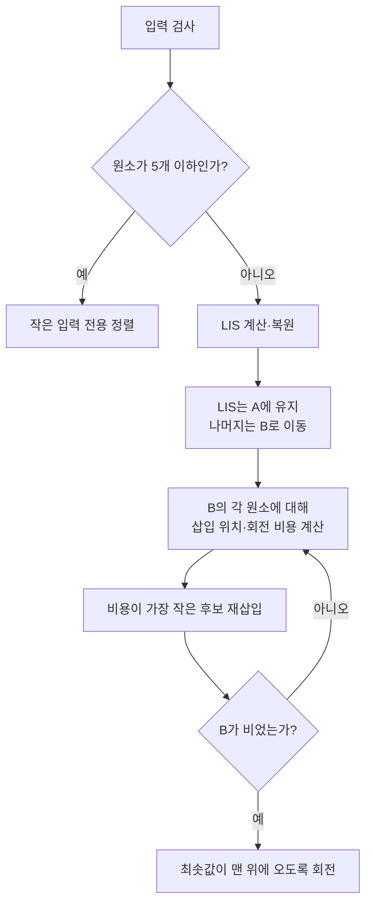

[← 전체 프로젝트](../../README.md)

<div align="center">

# push_swap

**두 스택과 제한된 연산 안에서 정렬 전략 설계하기**


`LIS 복원` · `회전 비용 비교` · `동시 회전`

</div>

## 무엇을 만들었는가

정수들을 두 스택 A·B와 정해진 연산만으로 정렬하고, 사용한 연산을 출력하는 프로그램입니다. 실행 시간과 별개로 **출력할 스택 연산 수를 줄이는 전략**을 설계하는 데 초점을 둡니다.

**사용 기술:** C, 배열 기반 스택, 동적 계획법, 탐욕적 선택, 직접 구현한 Libft·ft_printf·get_next_line.

| 연산 | 동작 |
| :--- | :--- |
| `sa` / `sb` / `ss` | 스택 위의 두 원소 교환 |
| `pa` / `pb` | 한 스택의 맨 위 원소를 다른 스택으로 이동 |
| `ra` / `rb` / `rr` | 맨 위 원소를 맨 아래로 회전 |
| `rra` / `rrb` / `rrr` | 맨 아래 원소를 맨 위로 역회전 |

## 과제에서 요구한 범위

[Subject v8.1](en.subject.pdf)의 필수 과제는 제한된 스택 연산으로 정렬하고 연산 수를 줄이는 것입니다. 보너스는 연산을 읽어 결과를 검사하는 `checker`입니다.

LIS나 특정 정렬 알고리즘은 지정되어 있지 않습니다. 이 코드에서는 **LIS를 남긴 뒤, 두 스택의 회전 비용을 비교해 재삽입하는 전략**을 선택했습니다. 다음 절에서 그 계산과 실행 순서를 설명합니다.

## 정렬 전략



### 1. 이미 정렬된 부분 수열을 남기기

[`push_swap_lis.c`](push_swap_lis.c)의 `get_table`은 `O(n²)` 동적 계획법으로 최장 증가 부분 수열(LIS)의 길이와 이전 원소 인덱스를 구합니다. `get_lis`는 이를 역추적해 실제 원소를 표시합니다. LIS에 속한 원소는 A에 남기고 나머지는 B로 옮깁니다.

### 2. 네 가지 회전 조합을 비교하기

[`push_swap_cost.c`](push_swap_cost.c)는 B의 각 원소가 들어갈 A의 위치를 찾고, 두 스택의 정회전·역회전 조합 네 가지를 비교합니다.

| A·B의 방향 | 회전 비용을 계산하는 관점 |
| :--- | :--- |
| 둘 다 정회전 | `rr`로 겹치는 회전을 묶음 |
| 둘 다 역회전 | `rrr`로 겹치는 회전을 묶음 |
| A 정회전 · B 역회전 | 두 이동량을 합산 |
| A 역회전 · B 정회전 | 두 이동량을 합산 |

현재 단계에서 비용이 가장 작은 원소를 고릅니다. 비용이 같으면 B의 회전 횟수가 작은 후보를 우선합니다.

### 3. 실제 연산에 비용 계산을 반영하기

[`rotate_stack`](push_swap_lis.c)는 같은 방향의 이동을 먼저 `rr`·`rrr`로 실행하고 남은 회전을 개별 처리합니다. 재삽입이 끝나면 최솟값까지 가까운 방향으로 회전합니다. [작은 입력](push_swap_sort.c)은 별도 경로로 처리합니다.

## 입력 처리

[인자 분리](push_swap_args.c)와 [숫자 검사](push_swap_parse.c)를 나누어, 여러 인자 또는 공백으로 묶인 정수 입력을 처리합니다. 숫자 형식, `int` 범위, 중복 값을 검사합니다.

## 빌드와 실행

```sh
make
./push_swap 4 1 3 2
./push_swap "4 1 3 2"

# 보너스 실행 파일
make bonus
./push_swap 4 1 3 2 | ./checker 4 1 3 2
```

`push_swap`은 정렬 연산을 한 줄씩 출력합니다. `checker`는 입력받은 연산을 적용한 뒤 `OK`, `KO` 또는 `Error`를 출력합니다.

**현재 checker의 범위:** [성공 판정](checker.c)은 A의 정렬 여부를 확인하며 B가 비었는지는 검사하지 않습니다. 결과 검증 시 이 조건을 함께 확인해야 합니다.

`make clean`, `make fclean`, `make re`를 지원합니다.

## 설계의 성격

각 재삽입 단계의 회전 비용을 비교하는 휴리스틱입니다. 전체 연산 수의 전역 최적성을 보장하지 않으며, 이 문서에는 별도 측정하지 않은 평균·최대 연산 횟수를 기재하지 않았습니다.

<a id="peer-feedback"></a>

## 동료 평가

### 평가자 `m**`

안녕하세요. 오랜만에 평가를 하기도 하고 제가 아직 해결하지 않은 과제인지라 긴장을 했었는데 피평가자님께서 평가 진행을 많이 도와주셔서 수월하게 평가가 이루어졌습니다ㅎ.ㅎ 문제 설명부터 코드 테스트 및 코드 리뷰까지 꼼꼼하게 설명해주셔서 이해가 쏙쏙 되었던 것 같아요! 피평가자님과 코드 테스트를 진행할 때 임의의 여러 숫자들을 넣어보고, 피평가자님의 로직대로 하나씩 실제로 값을 넣어보니 더 이해가 잘 되더라고요. 제가 문제에 대한 이해를 하는데에 많은 시간이 소요되는 편인데 피평가자님의 깔끔한 요약으로, 다음에 제가 이 과제를 하게 될 때 많은 도움이 될 것 같습니다. 정말 좋은 평가 시간이었습니다! 좋은 결과 있으시길 바랍니다 😉~~~!!

---

### 평가자 `j**`

안녕하세요. 저도 같은 과제를 진행하고 있어서 여러가지 정보들을 물어봤고 예외처리에 관한 꿀팁들도 알려주셨습니다! 그리고 lis 알고리즘을 사용하셨는데 몰랐던 알고리즘이라 질문했었는데 친절하게 잘 설명해주셨습니다. 신기한 알고리즘을 배워갈 수 있어서 좋았고 과제하느라고 고생많으셨습니다!!

---

### 평가자 `s**`

lis 알고리즘을 활용하여 push_swap을 구현하신 분은 처음 봤는데 정말 신기하고 오히려 이걸 활용하는 것이 더 좋은 것 같다는 생각도 들었습니다. 기본적으로 알고리즘이 진행되는 방식, 코드., 테스트 까지 많은 것들을 보여주셔서 정말 흥미롭게 들었습니다. 열정을 가지고 처음부터 끝까지 모든 것을 차근차근 설명해주셔서 감사합니다. 화이팅

