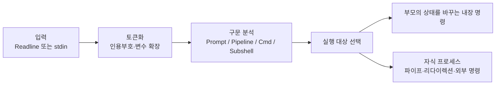

[← 전체 프로젝트](../../README.md)

<div align="center">

# Minishell

**입력을 해석하고 프로세스를 실행하는 작은 Unix 셸**


`구문 트리` · `범용 동적 배열` · `파이프라인` · `환경변수·와일드카드`

</div>


## 무엇을 만들었는가

사용자의 명령을 읽고 토큰과 구문 트리로 해석한 뒤, 내장 명령 또는 외부 프로그램을 실행하는 C 기반 셸입니다. 단순 명령 실행에서 나아가 파이프라인, 리다이렉션, here_doc, 논리 연산자, 괄호 그룹, 와일드카드를 처리합니다.

**사용 기술:** C, GNU Readline·History, `fork`, `pipe`, `dup2`, `execve`, `waitpid`, `sigaction`, 디렉터리 API.

### 개인 기여와 협업

| 구분 | 담당 범위 |
| :--- | :--- |
| **개인 구현** | **시그널 관련 부분을 제외한 주요 셸 기능 구현** — 입력 처리, 토큰화·구문 분석, 동적 배열, 환경변수·와일드카드, here_doc, 내장 명령, 파이프라인·실행 로직 |
| **팀원 구현** | 시그널 관련 부분 |

아래 기능 설명은 공동 결과물 전체를 다루며, 개인 담당 범위는 위 표를 기준으로 구분합니다.

## 과제에서 요구한 범위

[Subject v9.0](en.subject.pdf)을 기준으로 구분하면 다음과 같습니다.

| 구분 | 명세의 요구사항 |
| :--- | :--- |
| 필수 | 프롬프트·히스토리, 명령 실행, 인용부호·환경변수, 파이프·리다이렉션·here_doc, 7개 내장 명령, 시그널 |
| 보너스 | `&&`·`\|\|`, 괄호에 따른 우선순위, **현재 디렉터리 안의** `*` 와일드카드 |

논리 연산자와 와일드카드는 지정된 보너스입니다. 이 코드에서는 와일드카드의 탐색 범위를 경로 구간으로 넓히고, FD 번호를 붙인 리다이렉션과 표준 입력으로 명령을 받는 경로를 더했습니다.

<a id="subject-extras"></a>

## 추가한 동작

| 추가 구현 | 동작 | 근거 코드 |
| :--- | :--- | :--- |
| 경로를 포함한 와일드카드 | `mandatory/srcs/*/*.c`처럼 `/`로 나뉜 구간을 차례로 탐색. 상대·절대 경로 처리 | [경로 분리·탐색](mandatory/srcs/globbing/minishell_glob.c) · [패턴 비교](mandatory/srcs/globbing/minishell_wildcard.c) |
| FD 번호 리다이렉션 | `cat missing_file 2> errors.txt`처럼 연산자 앞의 FD 번호를 읽어 해당 출력 연결 | [토큰화](mandatory/srcs/lexing/minishell_lex.c) · [구문 분석](mandatory/srcs/parsing/minishell_parse_cmd.c) · [FD 연결](mandatory/srcs/executing/minishell_redir.c) |
| 표준 입력으로 명령 전달 | TTY에서는 Readline, 파이프 등으로 들어온 입력은 줄 단위로 읽어 실행 | [입력 모드 설정](mandatory/srcs/main/minishell_set.c) · [입력 처리](mandatory/srcs/scanning/minishell_readline.c) |
| 환경 초기화 | 시작할 때 `SHELL` 경로와 `SHLVL` 설정, 셸 중첩 단계 증가와 상한 경고 처리 | [환경 초기화](mandatory/srcs/main/minishell_set.c) |
| 터미널 표시 | 커서 위치를 조회해 줄바꿈 없이 끝난 출력 뒤의 프롬프트 표시 조정, TTY 시작 화면 | [커서·프롬프트](mandatory/srcs/scanning/minishell_readline.c) · [시작 화면](mandatory/srcs/widget/minishell_art.c) |

## 전체 기능

| 영역 | 구현 내용 |
| :--- | :--- |
| 입력 | 컬러 프롬프트, 히스토리, TTY·표준 입력 모드, 보조 프롬프트 |
| 구문 | 파이프 `\|`, `&&`·`\|\|`, 괄호 서브셸 |
| 리다이렉션 | `<`, `>`, `<<`, `>>`, 숫자로 지정하는 FD |
| 확장 | `$VAR`·`$?`, 인용부호 처리, `*` 와일드카드 |
| 실행 | 내장 명령, `PATH` 탐색, 외부 프로그램, 종료 상태 전달 |
| 시그널 · 팀원 담당 | 입력·here_doc·자식 실행 상황에 따른 `SIGINT`·`SIGQUIT` 처리 |

## 입력부터 실행까지



### 직접 만든 동적 배열로 데이터 관리

[`minishell_vector.c`](mandatory/srcs/common/minishell_vector.c)의 `t_vec`는 원소 크기, 길이, 용량, 해제 콜백을 보관합니다. 용량이 부족하면 두 배로 늘리고, 토큰·환경변수·구문 노드에 맞는 정리 함수를 연결합니다.

같은 컨테이너를 여러 자료형에 재사용하며 [구문 트리 정리](mandatory/srcs/main/minishell_reset.c)와 [요소별 해제](mandatory/srcs/parsing/minishell_parse_utils.c)를 구성했습니다.

### 명령 구조를 구문 트리로 표현

[토큰화](mandatory/srcs/lexing/minishell_lex.c)는 단어·연산자·인용부호를 처리하고, [파서](mandatory/srcs/parsing/minishell_parse.c)는 프롬프트·파이프라인·명령·서브셸 노드를 구성합니다. 괄호 내부는 재귀적으로 해석하고, 논리 연산자는 앞 실행 결과에 따라 다음 파이프라인을 실행할지 결정합니다.

### 부모 상태 변경과 자식 실행을 구분

단독으로 실행되는 `cd`·`export`·`unset`·`exit`는 [부모 실행 경로](mandatory/srcs/executing/minishell_builtin.c)로 보냅니다. 파이프라인 안의 명령은 자식에서 실행해 상태 변경 범위를 분리합니다.

[파이프라인 실행](mandatory/srcs/executing/minishell_run_pipex.c)은 파일 디스크립터를 연결하고, [외부 명령 실행](mandatory/srcs/executing/minishell_external.c)은 `PATH` 또는 지정 경로로 실행 파일을 찾습니다. 마지막 명령의 종료 상태를 파이프라인 결과로 사용합니다.

### 디렉터리를 순회하는 와일드카드 확장

[글로빙](mandatory/srcs/globbing/minishell_wildcard.c)은 경로를 구간별로 탐색하고 `*` 패턴을 재귀적으로 비교합니다. 디렉터리 항목을 정렬하고, 점으로 시작하지 않는 패턴에서는 숨김 파일을 제외합니다. [인용부호 처리](mandatory/srcs/globbing/minishell_glob_utils.c)로 따옴표 안의 별표와 확장할 별표를 구분합니다.

### here_doc과 상황별 시그널 처리

[here_doc](mandatory/srcs/heredoc/minishell_heredoc.c)은 임시 파일에 입력을 모으고, 구분자에 인용부호가 있으면 본문 변수 확장을 생략합니다.

팀원이 구현한 [시그널 처리](mandatory/srcs/signal/minishell_signal.c)와 [핸들러](mandatory/srcs/signal/minishell_handler.c)는 `volatile sig_atomic_t` 플래그와 `sigaction`을 사용합니다. 프롬프트, 보조 입력, 자식 프로세스의 실행 상황에 맞춰 동작을 전환합니다.

## 내장 명령

| 명령 | 구현 내용 |
| :--- | :--- |
| `echo` | 문자열 출력, 반복되는 `-n` 옵션 |
| `cd` | 디렉터리 변경, `PWD`·`OLDPWD` 갱신 |
| `pwd` | 현재 디렉터리 출력 |
| `export` | 환경변수 추가·수정, 정렬된 선언 목록 출력 |
| `unset` | 환경변수 제거 |
| `env` | 값이 있는 환경변수 출력 |
| `exit` | 숫자 인자 검사와 종료 코드 처리 |

## 빌드와 실행

C 컴파일러, `make`, GNU Readline 개발 라이브러리가 필요합니다. 링크 옵션은 `-lreadline`이며 환경에 따라 추가 터미널 라이브러리가 필요할 수 있습니다.

```sh
make
./minishell
```

보너스 빌드도 같은 이름의 실행 파일을 만듭니다.

```sh
make bonus
./minishell
```

현재 기본·보너스 구현은 파일명·헤더명의 접미사를 제외하면 같은 기능을 포함합니다. `make clean`, `make fclean`, `make re`를 지원합니다.

### 셸 안에서 실행하는 예시

```sh
export NAME=world
echo "Hello $NAME"
printf hello | wc -c
echo test > result.txt
cat < result.txt | wc -l
false || echo fallback
true && echo success
(echo first && echo second) | cat
echo *.c
echo mandatory/srcs/*/*.c
cat missing_file 2> errors.txt
```

here_doc:

```sh
cat << END
hello
END
```

외부 셸에서 표준 입력으로 명령 전달:

```sh
printf 'echo hello\n' | ./minishell
cat script.sh | ./minishell
```

<details>
<summary>구현 범위와 추가 검증 항목</summary>

닫히지 않은 따옴표가 있으면 [보조 입력](mandatory/srcs/scanning/minishell_scan.c)으로 이어 받는 동작도 있습니다. 명세는 닫히지 않은 따옴표를 해석하지 않도록 명시하므로, 이 동작은 명세와 구분해 보아야 합니다.

위 기능을 구현한 교육용 셸이며 Bash·POSIX 셸 전체와의 호환성을 보장하지 않습니다. 변수 확장은 토큰화 단계에서 수행합니다. 한 줄의 연속 명령 사이에서 바뀐 환경변수의 확장 시점, 부모에서 실행하는 내장 명령의 리다이렉션, here_doc 임시 파일 정리는 추가 검증할 항목입니다.

</details>

## 코드 탐색

[`main/`](mandatory/srcs/main/) · [`scanning/`](mandatory/srcs/scanning/) · [`lexing/`](mandatory/srcs/lexing/) · [`parsing/`](mandatory/srcs/parsing/) · [`executing/`](mandatory/srcs/executing/) · [`envs/`](mandatory/srcs/envs/) · [`builtin/`](mandatory/srcs/builtin/) · [`signal/`](mandatory/srcs/signal/)

## 참고 자료와 개발 도구

기존 프로젝트 문서의 참고 자료: Bash·POSIX 셸 매뉴얼, GNU Readline 문서, `fork(2)`·`execve(2)`·`pipe(2)`·`dup2(2)`·`waitpid(2)`·`signal(7)` 매뉴얼, *Advanced Programming in the UNIX Environment*.

기존 문서에 기록된 AI 활용 범위는 허용 함수의 기본 사용 예시, 함수 이름 제안, 테스트 케이스 생성입니다. 이 README의 구성과 문장 정리에도 AI 도움을 사용했습니다.

<a id="peer-feedback"></a>

## 동료 평가

### 평가자 `d**`

안녕하세요. 평가가 아니라 오히려 강의를 듣는 기분으로 1시간 반 동안 열정적으로 설명해주신 내용 잘 들었습니다. 우선 C++의 벡터처럼(저는 이 개념을 여기서 처음 알았어요 아직 c++ 안해봐서 ㅠㅠ) t_vec를 직접 구현해서 토큰과 환경변수를 관리하시는 점이 신선했습니다. 설명해주시기로는, 순정(?) C언어에서 이런 식의 아키텍처가 원래 없어서 직접 구현해 사용하셨다고 했는데 그렇게 원하는 아키텍처를 구현할 수 있다는 점이 능력이 부족한 저로서는 너무 신기했습니다. 과제 요구사항은 당연히 전부 잘 구현하셨고, 진짜 Bash처럼 만드셔서 놀랐어요. 보너스 파트까지 하셨는데, 실수로 따옴표를 안 닫았을 때 그냥 에러가 나는 게 아니라 secondary prompt가 뜨면서 입력을 계속 받도록 만드셨다고 설명해주셨는데요 실제로 실행도 똑같이 되더라고요 여기까지 다들 하시는지는 모르겠지만 정말 대단했습니다... 제가 할 수 있을지 걱정이 되네요. 인터랙티브 모드와 파이프로 넘겨줬을 때는 Bash의 논인터랙티브 모드처럼 구현하신 것 까지 충분히 outstanding 받으실만한 정도로 과제를 열심히 하신 것 같습니다. 모르는 개념이 더 많다보니 개념 설명에 테스트 케이스 확인, 코드리뷰까지 오랜 시간이 걸렸네요. 자세한 설명 잘 듣고 갑니다!! 너~~~~무 고생많으셨어요!!!!!!!!!

---

### 평가자 `s**`

저는 아직 minishell 과제를 시작하지 않았지만 바로 다음 서클 과제라서 이것저것 질문을 많이 드렸는데, 피평가자님이 구조부터 개념까지 정말 친절하게 설명해주셨습니다. 평가지 지침에 따라 기능 테스트를 먼저 쭉 진행하고 코드를 살펴보는 방식으로 평가했습니다. README 파일을 워낙 상세하게 작성해주셔서 전체적인 흐름을 이해하는 데 아주 큰 도움이 되었습니다. lexing이랑 parsing의 개념을 굉장히 자세하게 설명해주셨는데 프로젝트가 커질수록 parsing도 되게 복잡해진다는 게 신기했습니다. 제가 이제까지 parsing이라고 생각했던 과정은 사실상 lexing에 가까웠다는 걸 이해했습니다. vector를 직접 구현하신 것뿐만 아니라 parsing을 위한 ast tree도 만드셨는데 학교에서 배웠던 자료구조 개념이 실제 코드에 사용된 걸 보니까 이론에 대한 이해도가 높아진 것 같았습니다. 또한 readline 라이브러리 자체의 누수를 valgrind 검사 결과에서 제외하려면 supp 파일을 만들어야 한다는 것도 알게 되었습니다. 덕분에 과제 들어가기 전에 미리 많이 배우고 갑니다! 정말 고생 많으셨습니당 :)

---

### 평가자 `m**`

안녕하세요. 쉘 처음 켰을 때 쉘 아트로 초콜릿 모양의 미니쉘이 시작되어서 너무 인상 깊었습니다. 저도 미니쉘 과제를 했지만, 파일이 99개여서 놀랬어요. 그렇지만 폴더가 각 기능과 목적에 맞게 이름을 붙여서 트리구조로 제출해주셔서 보기에 깔끔했어요. 모든 평가요소를 꼼꼼히 확인해드렸고 모두 충족하였습니다. 저는 보너스 과제를 하지 않아서 보너스 파트에 대해 많이 여쭤보았는데 성섬성의껏 대답해주셔서 감사합니다. 앞 조건에 따라 뒷 조건의 실행 여부가 결정되는 논리연산자(&&, ||)의 개념을 알게 되어 유익했습니다. 다음에 다른 과제에서 사용해보고 싶었어요!! 제가 경로 유효성 판단 규칙에 대해 질문 드렸는데, 쉘 프롬프트의 명령어/인자/리다이렉션 대상은 모두 경로 형태고 각 경로는 부모경로와 basename으로 나눌 수 있어서 부모경로 자체가 없는 경우와, 부모경로는 존재하지만 basename만 없는 경우를 구분해서 에러 처리를 해야 한다고 답변을 주셨습니다. 새로운 개념들을 배울 수 있어서 너무 좋았습니다. 과제를 너무 열심히 하신게 보여서 감탄하면서 평가했어요!

