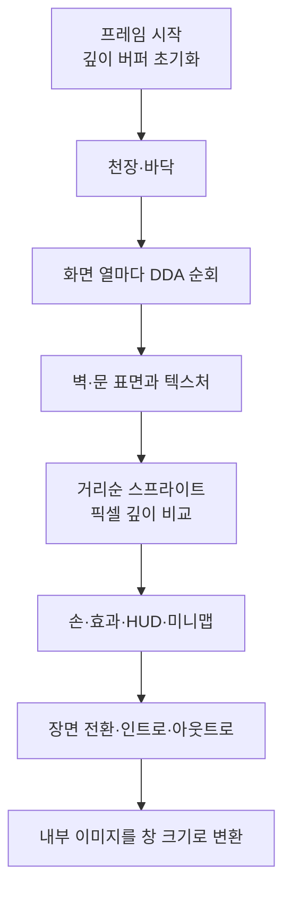

[← 전체 프로젝트](../../README.md)

<div align="center">

# cub3D

**레이캐스팅에서 출발해 라운드형 1인칭 게임으로**


`DDA` · `픽셀별 깊이 처리` · `문 형상 추출` · `적 상태 전환` · `라운드·재시작`

</div>


## 무엇을 만들었는가

2차원 지도를 1인칭 시점으로 보여주는 C 기반 레이캐스팅 렌더러입니다. 기본 구현에서 벽 텍스처와 카메라 이동을 처리하고, 보너스에서는 해바라기를 모아 집으로 돌아가는 게임으로 확장했습니다.

빈센트 반 고흐와 *해바라기*를 모티브로, 문·소품·적·회복 및 장비 아이템·HUD·미니맵·스토리 화면·여러 라운드를 구성했습니다.

**사용 기술:** C, MiniLibX, X11·Xext, 수학 라이브러리, 픽셀 버퍼, 직접 구현한 동적 배열·Libft 유틸리티.

### 개인 기여와 협업

| 구분 | 담당 범위 |
| :--- | :--- |
| **개인 구현** | **파서를 제외한 구현 전체** — 렌더링, 카메라·입력, 충돌, 문·스프라이트, 적·아이템, UI·애니메이션, 라운드·스냅샷, 자원 로딩·정리 |
| **팀원 구현** | 파서 |

아래 문서는 전체 프로그램을 소개합니다. 입력 파일의 해석은 협업 파트이며, 개인 구현의 핵심은 렌더러와 게임 로직입니다.

## 과제에서 요구한 범위

[Subject v12.0](en.subject.md)의 필수 과제는 `.cub` 장면을 읽어 1인칭 화면으로 보여주는 레이캐스팅 프로그램입니다.

| 구분 | 명세의 요구사항 |
| :--- | :--- |
| 필수 | 동·서·남·북 벽 텍스처, 바닥·천장 색상, 키보드 이동·회전, 장면 파일 검증, 창·종료 처리 |
| 보너스 | 벽 충돌, 미니맵, 열고 닫는 문, 애니메이션 스프라이트, 마우스 회전 |

HUD·체력 표시·무기·바닥 텍스처는 명세의 예시에도 등장합니다. 여기서는 그 요소들을 활용해 수집 목표, 전투, 라운드 진행과 재시작 규칙을 구성했습니다. 아래 확장과 세부 구현은 파서를 제외한 개인 담당 범위에 해당합니다.

<a id="subject-extras"></a>

## 게임으로 확장한 부분

| 직접 정한 규칙·구조 | 구현 내용 | 근거 코드 |
| :--- | :--- | :--- |
| 수집 목표와 라운드 | 해바라기 11개를 모아 목표 지점에서 상호작용, 최대 10개 맵을 순서대로 진행 | [목표 달성](srcs/084_key_press_bonus.c) · [게임 진행](srcs/082_exec_app_bonus.c) |
| 다음 라운드로 상태 전달 | 체력·점수·장비 충전량을 유지하며 다음 맵으로 이동 | [라운드 상태](srcs/104_round_bonus.c) |
| 실패 후 재시작 | 시작 상태를 저장하고 카메라·플레이 상태·엔티티를 복원, 문·입력 상태 재설정 | [스냅샷](srcs/043_snapshot_bonus.c) |
| 적 행동 | 순찰·추적·공격·피격·사망 상태, 거리·시야 방향·장애물에 따른 플레이어 탐지 | [상태 전환](srcs/095_exec_mobs_bonus.c) · [탐지·이동](srcs/097_mob_move_bonus.c) |
| 아이템 배치와 자원량 | 기존 배치와의 거리를 고려한 목표 아이템 분산, 적 구성에서 장비·회복량 예산 계산 | [목표 배치](srcs/053_init_item_goal_bonus.c) · [공격 자원](srcs/031_count_power_bonus.c) · [회복량](srcs/032_count_heal_bonus.c) |
| 게임 화면 흐름 | 시작·규칙·프롤로그, 화면 전환 효과, 실패·클리어·아웃트로와 재시작 버튼 | [장면 표시](srcs/079_draw_scene_bonus.c) · [재시작 입력](srcs/085_mouse_press_bonus.c) · [진행 제어](srcs/082_exec_app_bonus.c) |

## 보너스 기능에 더한 처리

문은 프레임 이미지에서 통로 형상을 추출해 그리기와 충돌에 함께 사용합니다. 열린 뒤에는 일정 시간이 지나면 자동으로 닫히며, 플레이어나 적이 통로를 막으면 닫힘을 조정합니다. 미니맵은 [플레이어를 중심으로 시선 방향에 맞춰 회전](srcs/078_draw_minimap_bonus.c)하도록 했습니다.

화면은 픽셀별 깊이 버퍼로 투명한 문·벽 장식과 스프라이트의 가림 관계를 처리합니다. [가로·세로 FOV 조절](srcs/087_fov_bonus.c)과 [동작 중 장비 입력을 보관하는 큐](srcs/100_hand_anim_bonus.c)도 구현했습니다. 아래에서 각 처리에 사용한 알고리즘과 자료구조를 설명합니다.

## 렌더링 구조



위 흐름은 보너스 기준입니다. 내부 `1920 × 1080` 이미지를 `1280 × 720` 창에 맞춰 표시합니다.

### DDA로 격자 경계를 따라 광선 추적

[`065_draw_wall.c`](srcs/065_draw_wall.c)는 카메라 방향과 평면으로 화면 열별 광선을 만들고, X·Y축 경계까지의 거리를 비교하며 지도를 순회합니다. 벽과 빈 공간이 만나는 표면을 수집하고 [거리순으로 그립니다](srcs/067_draw_wallfaces.c).

[보너스 벽 렌더링](srcs/068_draw_wallfaces_bonus.c)은 투명한 색을 건너뛰고 픽셀마다 깊이를 비교합니다. 문·벽·스프라이트가 겹칠 때 표면의 거리로 가림 관계를 처리합니다.

### 이미지에서 문 통로의 형상을 추출

[`051_get_door_jamb_bonus.c`](srcs/051_get_door_jamb_bonus.c)는 문 프레임 이미지의 하단과 연결된 투명 영역을 **큐 기반 flood fill**로 탐색합니다. 여기서 왼쪽·오른쪽 문틀과 윗부분의 윤곽을 추출해, [문 표면 그리기](srcs/069_draw_doorfaces_bonus.c)에 사용합니다.

[문 통로 충돌](srcs/090_door_portal_bonus.c)은 추출된 통로 폭으로 충돌 영역을 구성합니다. [열림·닫힘 상태](srcs/093_exec_door_bonus.c)는 진행률과 시간을 관리하며, 통로 안에 플레이어나 적이 있으면 닫힘을 조정합니다.

### 카메라 공간으로 변환하는 스프라이트

[빌보드 투영](srcs/074_billboard_bonus.c)은 카메라 변환의 역행렬로 상대 위치를 화면 좌표와 크기로 바꿉니다. [스프라이트 수집·정렬](srcs/075_sprite_collect_bonus.c) 후 깊이 버퍼와 비교해 그립니다.

[적 텍스처 선택](srcs/076_mob_sprite_bonus.c)은 적의 방향과 플레이어 위치 사이의 각도를 이용해 앞·뒤·좌·우 이미지를 선택하고, 공격·피격·사망 상태에는 해당 애니메이션을 적용합니다.

## 게임 로직

### 시야와 장애물을 고려하는 적 상태 전환

[적 갱신](srcs/095_exec_mobs_bonus.c)과 [상태별 동작](srcs/096_mobs_mode_bonus.c)을 나누어 `순찰·추적·공격·피격·사망` 상태를 관리합니다.

[플레이어 탐지](srcs/097_mob_move_bonus.c)는 거리와 방향 벡터의 내적으로 시야를 검사하고, 이동 경로를 따라 벽·소품의 가림 여부를 확인합니다. 이동 시에는 축 정렬 경계 상자(AABB)의 겹침을 이용해 [충돌](srcs/092_collision_bonus.c)을 처리합니다.

### 아이템 분포와 전투 자원 계산

[해바라기 배치](srcs/053_init_item_goal_bonus.c)는 후보 위치에서 플레이어와 기존 아이템까지의 최소 거리를 비교해 아이템들이 퍼지도록 선택합니다. 적은 [종류별 수량 계산](srcs/030_count_mob_bonus.c)과 [섞기](srcs/058_init_mob_list_bonus.c)를 거쳐 배치합니다.

적 구성에서 [필요 공격 자원](srcs/031_count_power_bonus.c)과 [회복량 예산](srcs/032_count_heal_bonus.c)을 계산하고, [회복 아이템](srcs/055_set_item_heal_bonus.c)과 [장비 아이템](srcs/057_set_item_gear_bonus.c)의 배치에 반영합니다. 난수는 [선형 합동 방식의 `ft_rand`](srcs/003_rand_time_bonus.c)를 사용합니다.

### 상태를 보관하고 복원하는 재시작

[스냅샷](srcs/043_snapshot_bonus.c)은 카메라·플레이 상태·엔티티 목록을 저장하고 복원합니다. 문 애니메이션과 입력 상태도 재설정합니다.

[라운드 전환](srcs/082_exec_app_bonus.c)은 장면 전환과 다음 맵 진입을 관리하며, [체력·점수·장비 충전량](srcs/104_round_bonus.c)을 다음 라운드로 전달합니다. [손 동작](srcs/100_hand_anim_bonus.c)은 진행 중에 들어온 장비 입력을 큐에 보관합니다.

## 빌드와 실행

Linux, C 컴파일러, `make`, X11·Xext 개발 라이브러리와 그래픽 디스플레이 환경이 필요합니다. MiniLibX 소스는 포함되어 있습니다.

```sh
# 기본 렌더러
make
./cub3D maps/mandatory.cub
```

```sh
# 보너스 게임
make bonus
./cub3D_bonus maps/round01_bonus.cub

# 여러 맵을 순서대로 진행
./cub3D_bonus maps/round01_bonus.cub \
    maps/round02_bonus.cub \
    maps/round03_bonus.cub
```

보너스의 실행 파일명은 **`cub3D_bonus`**입니다. 기본·보너스 빌드를 전환하면 다른 쪽 실행 파일과 빌드 디렉터리를 제거합니다. `make clean`, `make fclean`, `make re`를 지원합니다.

## 조작과 목표

| 입력 | 동작 |
| :--- | :--- |
| `W` · `A` · `S` · `D` | 이동 |
| `←` · `→` | 회전 |
| 마우스 왼쪽 드래그 | 시점 회전 |
| `Space` | 앞의 문 또는 목표 지점과 상호작용 |
| `Z` | 기본 손 상태로 전환 |
| `X` | 장비 상태로 전환·다음 장비 선택 |
| `C` | 선택한 장비 사용 |
| `Q` / `E` | 가로 시야 범위 감소 / 증가 |
| `F` / `R` | 세로 시야 범위 감소 / 증가 |
| `Esc` | 종료 |

보너스에서는 **해바라기 11개를 모아 `G` 타일 앞에서 상호작용**하면 라운드를 마칩니다. 수집은 기본 손 상태에서 이루어지며, 장비·회복 아이템과 적을 함께 고려하며 이동합니다. 시작 화면의 Rules 버튼으로 규칙을 볼 수 있습니다.

<details>
<summary>맵 형식과 입력 처리 · 협업 파트</summary>

기본 장면 파일은 `NO`·`SO`·`WE`·`EA` 텍스처 경로, `F`·`C`의 RGB 색상, 마지막의 지도 영역으로 구성됩니다. `1`은 벽, `0`은 바닥, `N`·`S`·`E`·`W`는 플레이어의 시작 위치와 방향입니다.

보너스는 소품·문·적·목표 타일과 추가 리소스를 정의합니다.

| 기호·식별자 | 의미 |
| :--- | :--- |
| `a`–`z` / `Da`–`Dz` | 문 타일 / 문당 5개 텍스처 |
| `M` / `Ma_F` 등 | 적 위치 / 방향·상태별 애니메이션 |
| `G` | 집·목표 타일과 텍스처 |
| `T` | 벽 장식 |
| `P` · `P_D` · `P_Aa` 등 | 손·피격 효과·장비 애니메이션 |
| `H` | HUD 이미지 |
| `I_M` · `I_Ha` · `I_Aa` 등 | 목표·회복·장비 아이템 |
| 사용 가능한 대문자 | 정의된 소품 |

[기본 맵](maps/mandatory.cub)과 [보너스 맵](maps/round01_bonus.cub)에서 실제 구성을 확인할 수 있습니다.

</details>

<details>
<summary>구현 범위</summary>

이 프로젝트는 2차원 격자와 레이캐스팅을 사용하는 소프트웨어 렌더러입니다. 적의 행동은 상태·거리·시야·충돌 규칙으로 구성했습니다. 이동과 일부 애니메이션은 프레임별 고정 증가량을 사용하고, 장면 전환·일부 상태 변화는 시각 차이를 사용합니다.

</details>

## 참고 자료와 개발 도구

- [Lode's Computer Graphics Tutorial — Raycasting](https://lodev.org/cgtutor/raycasting.html)
- [42Paris MiniLibX Linux](https://github.com/42Paris/minilibx-linux) 및 포함된 매뉴얼
- [MiniLibX tutorial — 42 Docs](https://harm-smits.github.io/42docs/libs/minilibx)
- [Linux rand(3) 매뉴얼](https://man7.org/linux/man-pages/man3/rand.3.html) — 난수 생성 패턴 참고
- 42 cub3D 과제 명세와 동료 평가 체크리스트

기존 문서에 기록된 AI 활용 범위는 README 작성·수정, 보너스 콘셉트와 게임 아이디어 구상, 몬스터 이미지 리소스 제작, 함수 이름 제안, 파싱·맵 검증·게임 경계 상황 검토입니다. 구현·디버깅 결정과 최종 코드 통합은 작성자가 검토하고 관리했습니다.

<a id="peer-feedback"></a>

## 동료 평가

### 평가자 `s**`

안녕하세요! 완성도가 정말 높은 작품이었습니다. 단순히 보너스만 구현한 수준이 아니라 아이템, 적, 랜덤 벽, 문 등 다양한 요소를 추가해 실제 게임을 플레이하는 느낌을 받았습니다. 보너스를 이렇게까지 완성도 높게 구현한 작품은 처음 봤는데, HP를 회복하는 아이템 등 세부적인 요소들도 잘 구현되어 있어 평가하는 내내 재미있게 플레이했습니다. 코드의 양도 상당했고, 오랜 시간과 많은 정성을 들여 개발하신 것이 느껴졌습니다. 긴 시간 정말 고생 많으셨습니다. 좋은 작품을 평가할 수 있어 즐거웠습니다!

---

### 평가자 `b**`

안녕하세요. cub3D 과제를 하라고 했더니 게임을 만드셨군요. 게임잼에 이걸 제출하셔야 하는데, 금년에는 없어서 무척이나 아쉽습니다. 스포가 될 것 같으니까 무슨 컨셉인지는 알려드리지 않겠지만  획득해야 하는 아이템의 랜덤 스폰, 라운드, hp, 몬스터 패턴 등등 보너스에서 볼 게 정말 많았습니다. 평가를 왔는데 피씨방에서 게임하고 자리를 뜨는 기분입니다. 이미지와 게임 로직 하나하나에 정말 디테일이 있었고(해바라기 11개까지.. 그리고, 아침/밤이 변한다든가) 평가를 하면서 신기하고 인상깊게 여긴 점을 기록해보겠습니다. - xpm 파일에서 투명도까지 고려해서 시각적으로 퀄리티가 높았습니다. - 준비하신 이미지가 정말 많았고, 한 땀 한 땀 장인 정신이 느껴졌습니다. - 모아야 하는 아이템이 너무 겹치지 않고, 장애물 위에 발생하지 않도록 랜덤스폰하게 만들어 놓으신 점 - 빌보딩 이라는 걸 알려주셨는데, 제가 여러 방향애서 바라보아도 동일한 이미지로 보여지는 것도 무척 신기했습니다. 게임을 만든다는 것 자체가, 진짜 과제와 별개로 추가해야할 로직들이 정말 많았을텐데요. 이를 정말 멋지게 구현해셔서 무척 재미있게 평가하고 갑니다. 이거 슬랙에 깃허브 올려서 널리 알리고 싶습니다. 저만 하는 건 안되는데, 미노타우로스의 미궁에 함께 고통받으셨으면 좋겠습니다.  너무 고생하셨습니다. 중간 중간 궁금한 점을 정말 세세하게 설명해주셔서 저도 cub3d를 좀 더 알아갈 수 있었습니다. 이런 느낌으로 트센도 나오면 정말 재미있을 것 같습니다. 다음 과제도 화이팅입니다!!

---

### 평가자 `m**`

안녕하세요. 필수 파트에서 뒤에 있는 벽이 작게 보이고 가까이 있는건 크게 보이는 부분에서 계산을 해서 하는지, 임의로 한건지가 궁금하여 질문을 드렸습니다. 질문에 대한 답변으로 raycasting을 활용하여 2D환경에서 3D처럼 보일 수 있게 구현한 DDA알고리즘으로 선을 찍어서 벽 충돌했을 때 그린다는 답변을 주셨습니다. 처음 알게 된 알고리즘이여서 신기했습니다! so_long 과제와 달리 3D인 점과 map이 직사각형이 아니어도 된다는 점이 신기했습니다. cub3D의 보너스 파트는 처음 평가를 해보았는데 정말 게임처럼 완성도가 높아서 정말 재밌게 평가했습니다. 게임에 스토리가 있어서 더 몰입감 있게 게임을 해볼 수 있었습니다. 저는 되게 아슬하게 게임을 성공하였는데 난이도 조절과 아이템 설정을 너무 잘하신 것 같았습니다!! 아주머니 아저씨가 저를 발견하면 자꾸 추격해서 눈에 안 띄고자 도망다녔습니다..ㅋㅋㅋ 정말 출시해도 좋을 것 같아요!! 이런 프로젝트를 평가해볼 수 있어서 너무 좋았습니다. 고생의 흔적이 너무 드러났고 파일이 정말 많았는데 앞에 숫자를 붙여서 더 쉽게 알아볼 수 있었고 전처리기로 mandatory와 bonus의 컴파일 플래그를 구분하신 점이 편리해보였습니다!! 많은 걸 배워갑니다! 고생 정말 많으셨습니다!!

